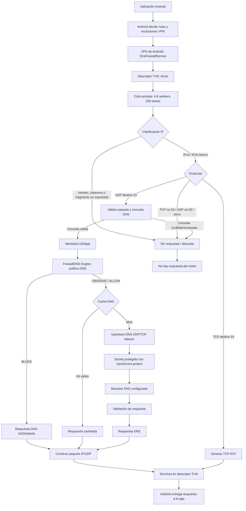

# FirewallDNS — mapa integral del recorrido de red

## Propósito

Este documento fija el recorrido real del tráfico según el código actualmente integrado en los repositorios **FirewallDNS** y **FirewallDNS-Engine**. Separa lo que ya ocurre en la VPN productiva de lo que existe solo como laboratorio. Su objetivo es sustituir pruebas aisladas y repetidas por un diagnóstico por etapas, con contadores que indiquen exactamente dónde entra, se clasifica, se procesa, se bloquea, se reenvía, responde o se descarta cada paquete.

**Regla:** ningún componente se considera integrado en producción solo porque tenga una clase, una prueba JVM o un ensayo loopback.

## 1. Mapa del plano productivo actual

### Lectura del mapa

- Android captura el tráfico que coincide con las rutas de DNS virtuales y las rutas añadidas para resolutores públicos conocidos. Las aplicaciones excluidas y la propia aplicación no pasan por este TUN.
- El lector TUN copia cada paquete y lo entrega a un executor acotado. Si la cola se satura, el paquete se rechaza y aumenta `queueRejectedPackets`.
- En producción, el servicio solo procesa consultas **UDP destino 53**. TCP destino 53 recibe un RST; TCP no-53, UDP no-53 y protocolos no soportados no se reenvían.
- IPv4 fragmentado y cabeceras de extensión IPv6 no están soportados en este camino. El parser IPv6 actual solo acepta UDP/TCP indicado directamente en la cabecera base.
- La decisión DNS usa el runtime compartido cuando está habilitado; si no, usa el evaluador del repositorio anfitrión. El modo OBSERVE registra la decisión que se habría tomado, pero permite continuar.
- Una consulta permitida consulta primero la caché; ante miss usa el upstream configurado y failover. Los sockets upstream deben protegerse antes de conectarse para evitar que vuelvan a entrar al TUN.
- La respuesta DNS se encapsula en IP/UDP y se escribe al descriptor TUN. Si la consulta es inválida/rechazada, el upstream falla sin respuesta utilizable, hay cancelación o el paquete no es compatible, puede no existir respuesta.

## 2. Qué está integrado y qué no

| Componente | Estado real | Límite |
|---|---|---|
| `DnsFirewallService` (VPN anfitriona) | Productivo | Es la única VPN productiva; DNS UDP es el camino soportado |
| Lector TUN y executor acotado | Productivo | Cuenta saturación y errores generales, pero todavía no clasifica todos los motivos de descarte |
| Motor de políticas DNS | Invocado por el camino DNS | No procesa tráfico IP general |
| Caché y cliente upstream DNS | Invocados por el camino DNS | Medir fallos/latencia por etapa para conocer dónde se pierde una respuesta |
| `AndroidEngineRuntime` | Composición Android disponible | No crea por sí mismo lector TUN ni plano de datos |
| `TunDnsPacketProcessor` | Adaptador DNS aislado con pruebas | No está conectado al lector TUN productivo de la app |
| `NativePacketCore` / Rust JNI | Experimental | Valida estructura de DNS UDP IPv4/IPv6; no decide políticas ni reenvía paquetes |
| `TunPacketDevice` + smoltcp | Laboratorio Rust | Colas/device y ensayos host-side; no consume el descriptor TUN Android productivo |
| `AndroidUdpFlowManager` | Componente Android experimental | Gestiona sockets/colas UDP protegidos, sin conexión al TUN productivo |
| `AndroidUdpTunBridge` | Diagnóstico aislado | Puente no-DNS UDP en VPN de laboratorio; excluye puerto 53 y no sustituye la VPN productiva |
| `UdpTunBridgeDiagnosticService` | APK de diagnóstico | Usa destino sintético y eco loopback; no demuestra forwarding a Internet |

## 3. Recorrido de salida de cada clase de tráfico

| Tráfico que entra al TUN productivo | Resultado actual |
|---|---|
| IPv4 UDP destino 53, consulta válida | Política → caché/upstream → respuesta IP/UDP al TUN |
| IPv6 UDP destino 53, sin extension headers, consulta válida | Política → caché/upstream → respuesta IP/UDP al TUN |
| DNS bloqueado | Respuesta DNS sintética NXDOMAIN al TUN |
| DNS en modo OBSERVE | Se registra OBSERVE y se permite el forwarding |
| DNS inválido o rechazado | Se descarta sin respuesta DNS |
| DNS upstream falla/cancelado | Puede quedar sin respuesta utilizable |
| TCP destino 53 | TCP RST; no hay DNS sobre TCP implementado en el camino productivo |
| TCP no-53 | No se reenvía |
| UDP no-53 | No se reenvía |
| IPv4 fragmentado | Se descarta |
| IPv6 con cabecera de extensión | Se descarta/no se interpreta |
| Otro protocolo o versión IP desconocida | Se descarta/no se interpreta |

Este mapa describe el código y no promete que Android enrute absolutamente todo el tráfico del dispositivo hacia la VPN. La cobertura exacta depende de las rutas, exclusiones y comportamiento del sistema.

## 4. Diagnósticos del dispositivo: evolución y límites

El informe más reciente de `Pruebas-en-el-celular` registra una sesión de 830319 ms:

| Contador | Informe anterior | Informe más reciente |
|---|---:|---:|
| Paquetes que entraron | 430 | 651 |
| DNS procesados | 390 | 594 |
| Respuestas escritas | 390 | 594 |
| Procesador devolvió respuesta | 390 | 594 |
| Procesador sin respuesta | 40 | 57 |
| Errores de procesamiento | 0 | 0 |
| Rechazos de cola | 0 | 0 |
| Errores de escritura | 0 | 0 |
| Detenidos antes de responder | 0 | 0 |
| BLOCK / OBSERVE / ALLOW | 0 / 12 / 378 | 0 / 25 / 569 |
| Descartados | 40 | 57 |
| Duración | 619057 ms | 830319 ms |

En el informe más reciente, 594 de 594 consultas contabilizadas como DNS procesadas recibieron respuesta. Los 57 paquetes restantes no obtuvieron respuesta DNS y figuran como descartados. La proporción de paquetes sin respuesta DNS sobre la entrada pasó de 40/430 (9,30 %) a 57/651 (8,76 %); esto no identifica por sí mismo la causa ni demuestra que esos paquetes fueran consultas DNS.

Los dos informes mantienen cero errores del procesador, cero rechazos de cola, cero errores de escritura y cero detenciones antes de responder. Esto acota las hipótesis: los contadores actuales no apuntan a saturación de la cola ni a fallos de escritura en esas sesiones. Pero no permiten clasificar los paquetes sin respuesta.

El informe más reciente protege la privacidad: no registra nombres de dominio ni payloads. Se debe conservar esa propiedad. **Falta protocolo, puerto de destino agrupado y motivo terminal por paquete** para conocer qué representan los 57.

## 5. Instrumentación necesaria para cerrar los puntos ciegos

Añadir un registro de contadores acumulativos y snapshots, sin guardar payload, dominio, IP completa ni datos personales. Los contadores mínimos:

1. **Entrada TUN:** paquetes/bytes por IPv4 e IPv6.
2. **Clasificación IP:** versión inválida, paquete corto, longitud inválida, fragmento IPv4, IPv6 extension header, protocolo IP.
3. **Clasificación transporte:** UDP/TCP/ICMP/otro; puertos de destino agrupados como DNS/53, no-DNS y no disponible.
4. **Decisión de ruta:** DNS procesado, TCP/53 RST, UDP no-DNS no soportado, TCP no-DNS no soportado, otro protocolo.
5. **DNS:** consulta válida, consulta inválida, BLOCK, OBSERVE, ALLOW, caché hit/miss, respuesta sintética, upstream intentado, upstream éxito/timeout/error/cancelación/respuesta inválida.
6. **Salida TUN:** respuesta construida, bytes escritos, error de escritura, sesión cerrada antes de escribir.
7. **Presión y ciclo de vida:** cola actual/máxima, rechazos por saturación, workers activos, flujos UDP activos, cierre/reinicio TUN.
8. **Tiempo por etapa:** entrada→clasificación, política, caché, upstream, construcción y escritura; percentiles P50/P95/P99 con reloj monotónico.

Cada paquete debe incrementar exactamente un resultado terminal por ruta (respondido, RST, no soportado, inválido, rechazado, sin upstream o error de salida). Los contadores por etapa pueden coexistir, pero los totales terminales no deben duplicarse.

### Privacidad y coste

- Contadores numéricos y categorías; no almacenar contenido de paquetes ni nombres de dominio.
- No hacer logging por paquete en producción; incrementar contadores atómicos y publicar snapshots a intervalos.
- Las métricas no deben bloquear el lector TUN, workers ni escritura de respuestas.
- Las etiquetas de flujo, si fueran necesarias para correlación temporal, serán identificadores efímeros en memoria y no persistentes.

## 6. Cómo usar el mapa para diagnosticar sin repetir pruebas

1. **Primero análisis estático:** seguir el código y confirmar el cableado real; ya se ha hecho para el recorrido descrito arriba.
2. **Después observabilidad pasiva:** añadir los contadores faltantes al camino productivo sin alterar decisiones ni forwarding.
3. **Un solo informe por sesión:** exportar snapshot inicial/final y deltas; separar Wi-Fi y datos móviles en sesiones distintas si se comparan.
4. **Diagnóstico dirigido:** solo si un contador identifica una etapa anómala, investigar esa etapa. No repetir pruebas de componentes que ya tienen evidencia automatizada suficiente.
5. **Prueba de integración imprescindible:** una validación controlada en dispositivo sigue siendo necesaria para demostrar TUN real, protección de sockets, retorno de paquetes, cambios de red y estabilidad. Ningún diagrama ni test de host puede demostrar esas propiedades físicas.

## 7. Siguiente trabajo recomendado

El siguiente cambio debe ser **observabilidad por etapa en la VPN productiva**, empezando por clasificar los 57 paquetes sin respuesta del informe más reciente y cada descarte silencioso. No conectar todavía smoltcp ni el puente UDP experimental al tráfico real. Cuando el mapa de contadores cierre la entrada y la salida de cada clase, se podrá decidir con evidencia qué parte del transporte conviene integrar y cuál no.

## Fuentes de código

- Aplicación anfitriona: `FirewallDNS/app/src/main/java/com/firewall/dns/service/DnsFirewallService.kt`
- Parser y construcción de paquetes: `FirewallDNS/app/src/main/java/com/firewall/dns/domain/engine/DnsPacketEngine.kt`
- Composición Android: `FirewallDNS-Engine/android-adapter/src/main/kotlin/com/firewalldns/engine/android/AndroidEngineRuntime.kt`
- Adaptador DNS aislado: `FirewallDNS-Engine/android-adapter/src/main/kotlin/com/firewalldns/engine/android/TunDnsPacketProcessor.kt`
- Puente UDP experimental: `FirewallDNS-Engine/android-adapter/src/main/kotlin/com/firewalldns/engine/android/AndroidUdpTunBridge.kt`
- Servicio de diagnóstico UDP: `FirewallDNS-Engine/device-diagnostics/src/main/kotlin/com/firewalldns/diagnostics/UdpTunBridgeDiagnosticService.kt`
- Core Rust y device smoltcp: `FirewallDNS-Engine/rust-core/src/lib.rs`, `rust-core/src/tun_device.rs`
