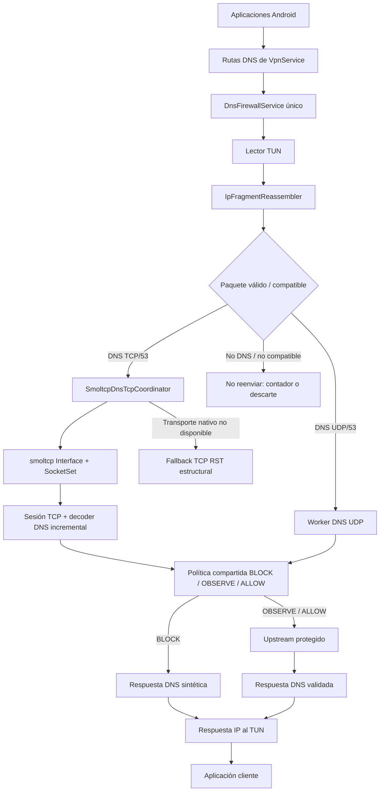

# FirewallDNS — mapa real del recorrido de red

## Estado verificado del código

El repositorio Android `candidohernandez148-spec/FirewallDNS`, rama `main`, commit `f1c124a`, ya conecta el transporte smoltcp DNS/TCP al `DnsFirewallService` productivo. Este mapa distingue esa integración de las pruebas de laboratorio y de las funciones que siguen fuera de alcance.

## 1. Ruta de entrada y decisiones

## 2. Qué hace la VPN productiva

- `DnsFirewallService` es el único `VpnService` productivo. Android enruta al TUN las direcciones DNS virtuales y los resolutores configurados en las rutas; la propia aplicación y los paquetes excluidos no entran por ese TUN.
- El lector TUN mantiene el orden de los segmentos TCP. Antes de clasificar, pasa los paquetes por `IpFragmentReassembler`, que tiene límites de memoria, cantidad de ensamblados y TTL monotónico.
- DNS UDP/53 sigue el worker DNS existente: parser → identidad de aplicación → motor de política → caché → upstream protegido → respuesta IP/UDP al mismo TUN.
- DNS TCP/53 entra en `SmoltcpDnsTcpCoordinator` cuando el transporte nativo está disponible: JNI bounded queue → un único hilo propietario de smoltcp → sesiones TCP → decoder incremental por sesión → política DNS compartida → upstream protegido → respuesta en el mismo flujo.
- El fallback que construye TCP RST es solo para paquetes TCP/53 que no entran en la ruta smoltcp (por ejemplo, transporte nativo no disponible o paquete no compatible). No significa que DNS/TCP esté globalmente deshabilitado.
- TCP/UDP general no-DNS no se reenvía en esta etapa. No se declara inspección de DoH, DoT o DoQ.

## 3. Contratos importantes

| Área | Estado y contrato |
|---|---|
| Servicio VPN | Un único `DnsFirewallService`; no crear un segundo `VpnService`. |
| Política | Una autoridad de decisiones `BLOCK / OBSERVE / ALLOW`; el modo OBSERVE permite continuar y registra lo que habría bloqueado. |
| smoltcp | `Interface` y `SocketSet` pertenecen a un solo hilo. Los workers DNS no los manipulan. |
| Colas | Límites de paquetes y bytes en JNI, dispositivo RX/TX, eventos y respuestas por sesión. |
| Upstream | `AndroidDnsSocketProtector` llama a `VpnService.protect()` antes de `connect()` para sockets UDP/TCP; el callback registra intentos, éxitos y fallos sin datos del socket. Si la protección falla, el intercambio debe fallar cerrado. |
| Fragmentación | Reensamblador IPv4/IPv6 acotado antes de clasificar. No equivale a soportar todas las extensiones IPv6 o jumbograms. |
| Privacidad | Los contadores son agregados; no deben persistir payloads, dominios ni direcciones completas. |

## 4. Semántica de métricas

- `dnsTcp`: paquetes de cliente TCP/53 observados, no número de consultas DNS completas.
- `smoltcpPacketsAccepted`: paquetes aceptados por la cola JNI, no significa que ya hayan sido procesados por smoltcp.
- `smoltcpIngressRejected`: rechazos acumulados en la cola JNI y en la cola RX interna del dispositivo smoltcp.
- `smoltcpSessionsOpened/Closed`: eventos de ciclo de vida de sesiones TCP DNS.
- `smoltcpNativeErrors`: fallos del límite JNI/poll, no incluye cada rechazo de cola.
- `queueRejected`: saturación del executor/cola de workers Android; es distinta de los rechazos internos smoltcp.
- `packetsWritten` y `writeErrors`: respuestas IP escritas al descriptor TUN y fallos de escritura.
- `upstreamProtectUdp*` y `upstreamProtectTcp*`: intentos y resultados booleanos de `VpnService.protect()` por transporte.

El contador de rechazos nativo se incrementa en los dos límites: validación/saturación de la cola JNI y error al transferir el paquete a `TcpDnsTransport`. El getter JNI solo lee un contador atómico y no toca `Interface`/`SocketSet` desde el lector TUN.

## 5. Evidencia y límites del diagnóstico

El último informe versionado guardado en `Pruebas-en-el-celular` registra 9 pruebas aprobadas, 0 fallidas y 18 no verificadas. En ese informe, el sistema reportaba una VPN activa, pero `firewall_dns_active` era falso. Por tanto, las pruebas aprobadas del motor local y de JNI no demuestran todavía la ruta productiva del teléfono.

Las pruebas de DNS UDP/TCP por IPv4/IPv6 requieren activar específicamente FirewallDNS y que el puente de métricas protegido esté disponible. IPv6 se marca no verificado cuando la red no ofrece conectividad IPv6 global.

## 6. Próximas pruebas en Samsung Galaxy A34 5G

1. Activar FirewallDNS, confirmar que el proveedor informa `firewallDnsRunning=1` y ejecutar la prueba completa.
2. Confirmar DNS UDP/53 y DNS TCP/53 IPv4; repetir IPv6 solo cuando la red lo soporte.
3. Verificar sesiones smoltcp abiertas/cerradas, respuestas, rechazos de ingreso, errores nativos y errores de escritura.
4. Verificar la protección de sockets upstream y ausencia de recursión.
5. Repetir en Wi-Fi y datos móviles, incluyendo cambio de red y reconexión.
6. Medir P50/P95/P99, pérdidas, throughput, CPU, memoria, batería y estabilidad prolongada.
7. Solo después comparar el transporte anterior y decidir qué código de diagnóstico puede retirarse.

## Fuentes de código

- `FirewallDNS/app/src/main/java/com/firewall/dns/service/DnsFirewallService.kt`
- `FirewallDNS/app/src/main/java/com/firewall/dns/service/FirewallDnsTrafficMetrics.kt`
- `FirewallDNS/android-adapter/src/main/kotlin/com/firewalldns/engine/android/SmoltcpDnsTcpCoordinator.kt`
- `FirewallDNS/android-adapter/src/main/kotlin/com/firewalldns/engine/android/NativeTcpDnsTransport.kt`
- `FirewallDNS/android-adapter/src/main/kotlin/com/firewalldns/engine/android/IpFragmentReassembler.kt`
- `FirewallDNS-Engine/rust-core/src/tcp_dns_transport.rs`
- `FirewallDNS-Engine/rust-core/src/native_tcp_jni.rs`